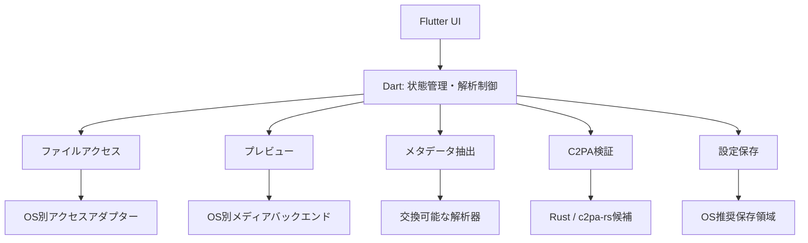

# アーキテクチャーと技術候補

状態：層の分離は方針として合意済み。ライブラリの採用とmacOS 27上の動作は未検証。

## 責務の分離

Dart側に表示モデル、検索、選択中のファイル、解析状態、設定スキーマを集約する。OS別のファイル権限や再生エンジン、解析ライブラリの固有出力はアダプター内に閉じる。

## インターフェースの責務

| 境界 | 入力・出力と責務 |
| --- | --- |
| ファイルアクセス | OS上の選択結果を、寿命管理できる読取専用のファイル参照へ変換する |
| プレビュー | ファイル参照を受け取り、表示・再生状態と利用可能な操作を提供する |
| メタデータ抽出 | ファイル参照を受け取り、項目一覧、進捗、警告、未対応範囲を返す |
| C2PA検証 | ファイル参照と検証方針を受け取り、各検証軸の状態と根拠を返す |
| 設定保存 | バージョン付き設定を読み書きし、OS別の保存先を隠蔽する |

単なるパス文字列の共有を前提にしない。macOSのsecurity-scoped URLやAndroidのcontent URIなど、OSのアクセス権を維持できる設計にする。必要な一時コピーは明示的に管理し、キャッシュとして削除可能にする。

## ファイルを開いたときの流れ

1. ファイル参照と読取権限を取得し、解析セッションを開始する。
2. プレビュー、メタデータ抽出、C2PA検証を独立して開始する。
3. 結果を共通モデルへ変換し、完了した部分から画面へ反映する。
4. ファイル切り替え・終了時にキャンセルし、参照・再生リソースを解放する。

セッション識別子で結果を照合し、古いファイルの遅延結果を現在の画面に反映しない。プレビュー失敗時も取得できたメタデータを表示し、C2PA失敗時も画像・動画の表示を継続する。処理中、未対応、キャンセル、失敗、部分成功を区別する。

重い処理はUIスレッドで実行しない。Dart isolateやネイティブのバックグラウンド処理を使い、FFIが自動的に非同期になるとは仮定しない。ファイル全体のメモリー読込を必須にせず、サイズ・時間・展開量に上限を設ける。上限による省略は画面に示す。

## 技術候補

| 領域 | 候補・検討方針 |
| --- | --- |
| 共通UI | Flutter。状態管理はRiverpodなどを試作で比較 |
| macOS画像 | ImageIOを利用するアダプター |
| macOS動画 | AVFoundation / AVPlayerを利用するアダプター |
| C2PA | c2pa-rsをRust層に組み込み、DartからFFIで呼び出す |
| メタデータ | 共通インターフェースを先に定め、抽出範囲・移植性・ライセンスを比較 |
| ファイル選択 | file_selectorなどとネイティブ権限管理の組み合わせ |
| ウィンドウ管理 | window_managerなどと必要なOS別補完 |

ImageIOとAVFoundationだけで全タグを網羅できるとは仮定しない。ExifToolは抽出結果を比較する参照ツールの候補とするが、製品への同梱は未決定。モバイル対応とストア配布のため、外部コマンド実行を必須にしない。FFmpegなども未採用であり、必要性・ビルド設定・ライセンスを確認するまで追加しない。

Rust境界では所有権、バッファ解放、エラー変換、キャンセル、ABIの互換性を定義する。ネイティブクラッシュは通常のDart例外では回復できないため、破損ファイルによる耐性検証を行う。プロセス分離の要否はデスクトップ試作で判断する。

## 依存関係と公開

採用時には固定バージョン、対応OS、ビルド方式、ライセンス・再配布条件、更新方針を記録する。独自コードがApache-2.0でも、依存関係が自動的に同じライセンスになるわけではない。採用した依存関係について第三者ライセンス一覧を追加する。

現時点ではアプリコード・パッケージ・ネイティブライブラリは追加していない。
